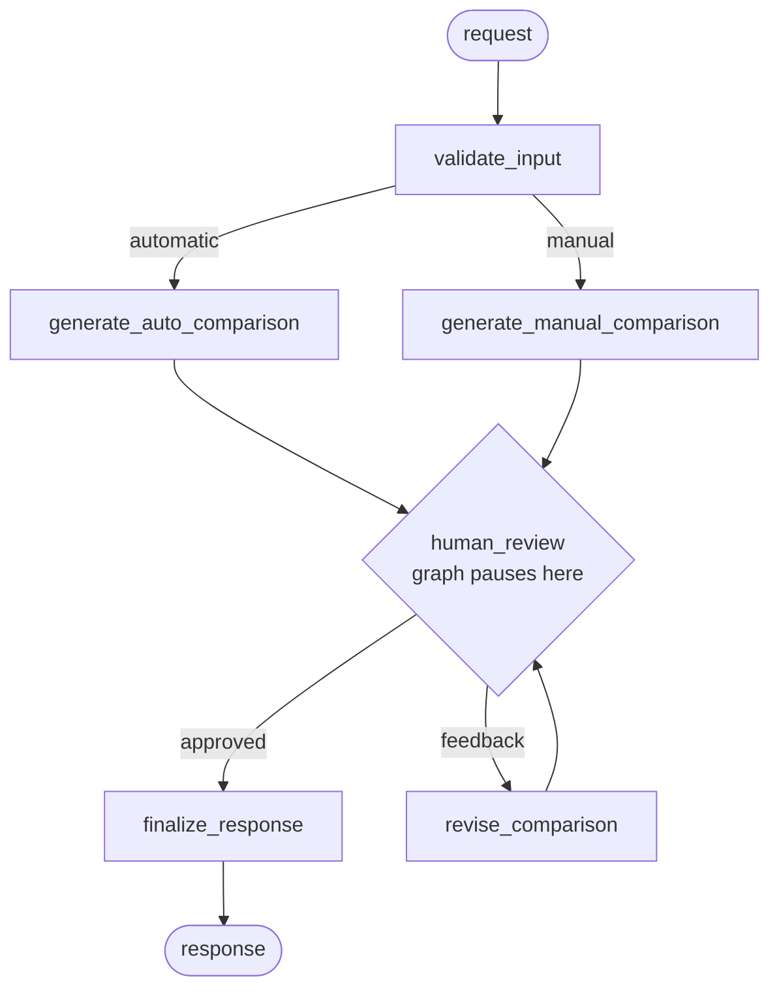

# DriveMatrix

A car spec browser with a LangGraph agent that explains what the numbers mean on the road: what torque does for overtaking, what AWD does in the wet, what a battery size means for range. Practice build, modelled loosely on CarDekho.

Two parts that are not connected yet:

- **Frontend** (React + Vite): browse, filter and compare 10 cars from `src/data/cars.ts`. The compare view marks the best value in each row (lowest price, most horsepower and so on).
- **Backend** (FastAPI + LangGraph): takes a list of cars and either writes a comparison or answers a question about them, then pauses for a human to approve or ask for a revision.

## How the agent works



- **Automatic mode** writes a comparison of the selected cars' specs.
- **Manual mode** takes a question. `llama-3.3-70b-versatile` extracts the intent as structured output, a TF-IDF search pulls the 2 closest passages from three local docs in `backend/app/data/rag_docs/` (drivetrains, EV charging, horsepower vs torque), and `llama-3.1-8b-instant` writes the answer.
- **Human review.** The graph stops before `human_review`. `POST /compare/review` with the `thread_id` approves the draft or sends feedback. A revised draft counts as approved, so there is at most one revision.
- **Memory.** Chat history keeps the last 50 messages. Older ones are folded into a running `summary` string, 80 characters each.

The two Groq models are split to stay under free-tier rate limits: the 70B model only for the structured intent call, the 8B model for everything else.

## Run it

Backend, from `Cars/backend`:

```bash
python3 -m venv venv
source venv/bin/activate
pip install -r requirements.txt
pip install scikit-learn                 # needed by app/rag.py, missing from requirements.txt
pip install -U "langgraph-cli[inmem]"    # only for option B
```

Put your keys in `Cars/.env`. The file in the repo is a template and is **not** gitignored, so don't commit your real key.

```env
GROQ_API_KEY=your_groq_api_key
LANGCHAIN_TRACING_V2=true
LANGCHAIN_API_KEY=your_langsmith_api_key
LANGCHAIN_PROJECT=drive-matrix
```

Then one of:

```bash
python run.py              # A: FastAPI on http://127.0.0.1:8000  (POST /compare/start, /compare/review)
langgraph dev --tunnel     # B: LangGraph dev server on port 2024
python verify_agent.py     # C: runs the graph end to end on sample cars (calls Groq)
```

Frontend, from `Cars`:

```bash
npm install
npm run dev                # http://localhost:5173
```

## Limitations

- The frontend does not call the backend. The agent is only reachable through the API, LangGraph Studio or `verify_agent.py`.
- No evals. Nothing checks whether the "what this means on the road" text is correct.
- Retrieval is TF-IDF over three short documents.
- Car data is a hand-written list of 10 cars.
