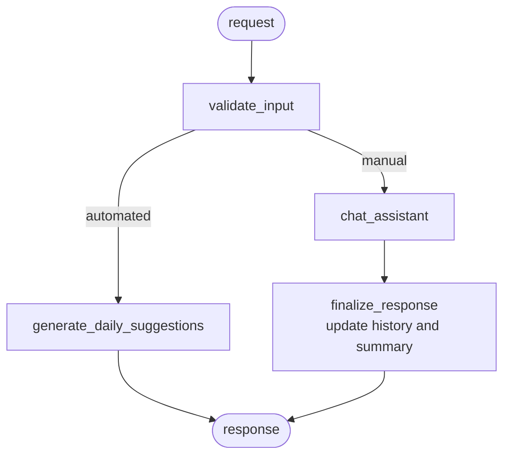

# Aura Styling

A stylist chatbot for a clothing shop. It remembers who you're shopping for, what they like and dislike, their sizes, and what they already own, and it won't suggest a grey jacket to someone who has one. It never talks about prices. Practice build: FastAPI, LangGraph and Groq, with a small web UI.

## How it works



- **Daily suggestions** (`POST /suggestions`): picks outfits from a 6-item mock catalog using the cart, clicks and past chats.
- **Chat** (`POST /chat`):
  1. A price question ("how much", "discount", "shipping"...) gets a fixed refusal, no model call.
  2. `llama-3.3-70b-versatile` pulls structured facts out of the message: who it's for, likes, dislikes, sizes, items already owned, how many pieces they want, their job.
  3. Those facts are saved per person in a local JSON file (`app/data/db.json`, seeded on first run).
  4. `llama-3.1-8b-instant` answers with the saved profile in the prompt. It is told to steer away from items the person already owns and to fit the style to their job.
  5. If the answer mentions a price, discount or currency amount, the request fails with HTTP 400 instead of returning it.
- **Memory:** chat history keeps the last 50 messages. Older ones are folded into a nested summary string, `((S + msg1) + msg2)`.

## Run it

From `Clothes`:

```bash
python3 -m venv venv
source venv/bin/activate
pip install -r requirements.txt
echo "GROQ_API_KEY=your_groq_api_key" > .env
```

Start the server and open http://127.0.0.1:8000/ for the UI:

```bash
venv/bin/python -m uvicorn app.main:app --reload --host 127.0.0.1 --port 8000
```

Tests (32, covering state, the JSON store, guardrails, graph routing and the API). They load the Groq client and some make live calls, so they need the key. The store is reset to seed data before each test:

```bash
PYTHONPATH=. venv/bin/pytest
```

## Limitations

- The "database" is one JSON file.
- The server keeps no sessions. The client sends chat history, summary and profiles with every request.
- Wardrobe items are text only. No image upload.
- Price blocking is regex. If the model's answer happens to use a word like "cost" or "sale", the user gets an error instead of an answer.
- No evals of styling quality.
